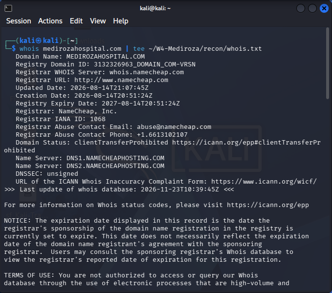
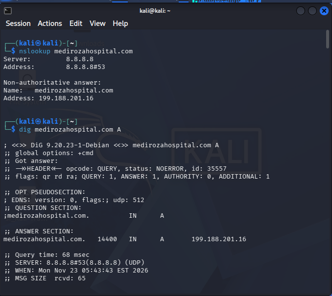
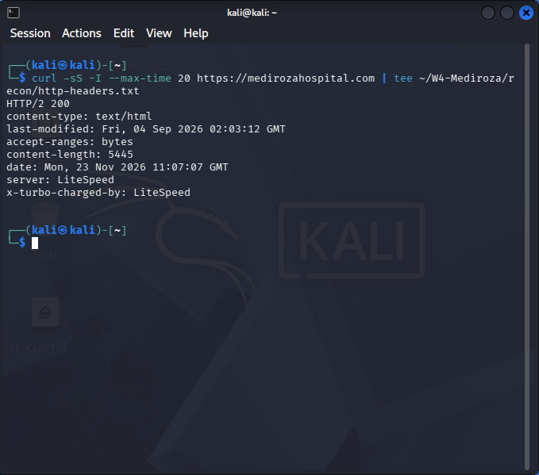
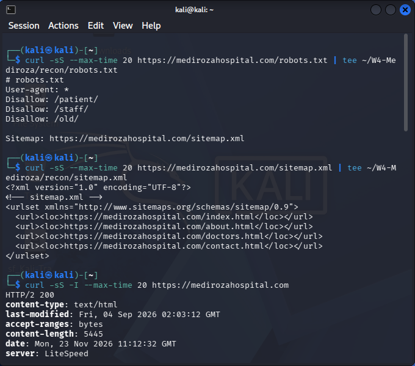
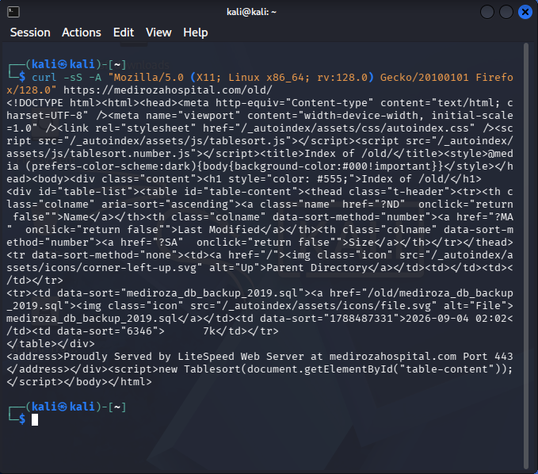
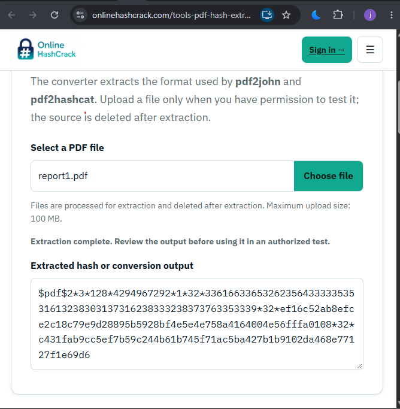
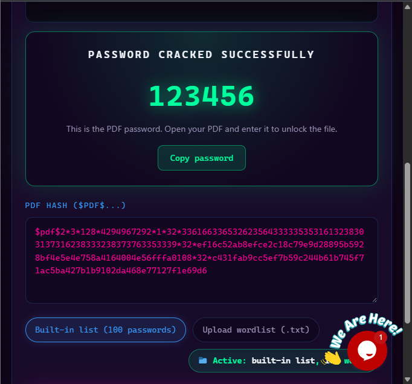
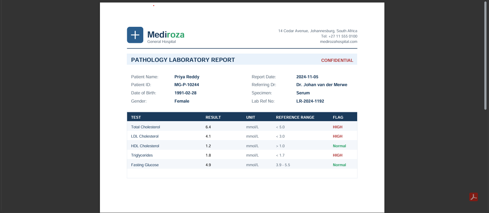
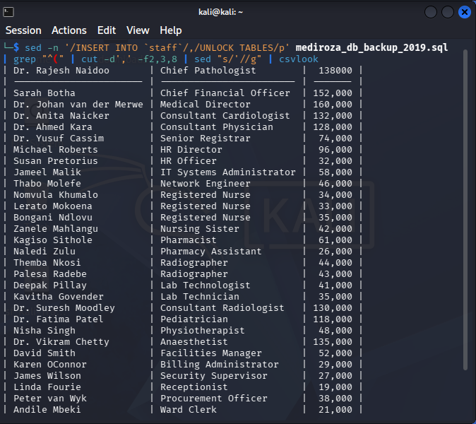

# NETWORKWALKS
## MEDIROZA GENERAL HOSPITAL
### WEEK 4 — PENETRATION TESTING REPORT

**A Five-Day Black-Box Penetration Testing Engagement**

**Prepared by:** Mutsiirwa Matembera Josué  
**Programme:** NetworkWalks Cybersecurity Internship  
**Batch:** B084  
**Week:** 04  
**Client:** Mediroza General Hospital  
**Target:** https://medirozahospital.com  
**Assessment Type:** Black-Box Penetration Testing  
**Duration:** 5 Days

---

# 1. Executive Summary

This report documents a black-box penetration testing assessment of Mediroza General Hospital's web infrastructure, conducted as part of the NetworkWalks Cybersecurity Internship Week 4 project.

The engagement followed the four milestones defined in the project brief:

- **M1 – Initial Access:** Conduct reconnaissance, identify exposed entry points, examine authentication behaviour, and retrieve the three PDF laboratory reports.
- **M2 – Data Extraction:** Examine the encryption protecting the three retrieved PDF files and recover access to their contents.
- **M3 – Further Data Exposure:** Investigate retrieved files and their metadata to identify the exposure of hospital employee salary information and shareholder details.
- **M4 – Penetration Testing Report:** Document the assessment, evidence, risk ratings, and recommended remediation.

The assessment identified multiple security weaknesses, including publicly accessible legacy backup material, weaknesses in the patient portal authentication workflow, insufficient protection of downloadable PDF reports, weak PDF passwords, and document metadata that revealed information about another exposed resource.

The most significant finding was the discovery of a publicly accessible SQL database backup in the website's legacy `/old/` directory. Analysis of this file exposed staff and shareholder records, demonstrating the potential impact of improperly protected backup files.

The findings demonstrate how weaknesses in access control, authentication, document protection, and information management can combine to expose sensitive organisational information.

**Overall assessment:** The observed weaknesses represent significant security risks and require remediation, particularly the publicly accessible database backup and the patient portal access-control weaknesses.

> **Assessment note:** This report documents observations from the authorised training engagement. Risk ratings are qualitative assessments based on the demonstrated impact and exposure, not formal CVSS scores.

# 2. Engagement Overview

| Item | Details |
|---|---|
| Client | Mediroza General Hospital |
| Target | `https://medirozahospital.com` |
| Project | Week 4 Penetration Testing |
| Programme | NetworkWalks Cybersecurity Internship |
| Batch | B084 |
| Assessment type | Black-box penetration testing |
| Duration | 5 days |
| Author | Mutsiirwa Matembera Josué |

## 2.1 Scope and Authorisation

The assessment was conducted against the target domain specified in the NetworkWalks Week 4 project brief.

The project brief granted written permission for security testing of the target's web infrastructure.

The agreed scope included:

- Reconnaissance of the target website and its publicly available information.
- Identification of exposed services and web application entry points.
- Examination of authentication mechanisms and application behaviour.
- Retrieval of the three specified PDF laboratory reports.
- Assessment of PDF encryption and password protection.
- Examination of retrieved files and their metadata.
- Investigation of the identified staff salary and shareholder information exposure.
- Documentation of findings and remediation recommendations.

### Rules of Engagement

The assessment followed the restrictions in the project brief:

- Testing was limited to the specified target domain.
- Social engineering was prohibited.
- Denial-of-service testing was prohibited.
- Testing outside the agreed scope was prohibited.
- Findings were documented without applying remediation changes to the target.

## 2.2 Objectives

The main objectives were to:

1. Identify information exposed through reconnaissance.
2. Discover accessible web directories and application entry points.
3. Examine the security of the patient portal.
4. Demonstrate whether the three PDF reports could be retrieved.
5. Evaluate the strength of the PDF encryption passwords.
6. Investigate the exposure of employee salaries and shareholder details.
7. Provide practical recommendations to improve the organisation's security.

# 3. Methodology

The assessment followed a structured penetration testing process.

| Phase | Activities |
|---|---|
| Preparation | Confirm target, scope, authorisation, and available tools |
| Reconnaissance | WHOIS, DNS, HTTP, TLS, and website information gathering |
| Enumeration | Web directory discovery and network service identification |
| Initial access | Review of patient portal authentication and report retrieval |
| Document assessment | PDF identification, hash extraction, and password recovery |
| Data analysis | Database backup and document metadata examination |
| Reporting | Evidence organisation, risk assessment, and recommendations |

The assessment used a combination of command-line tools, browser-based inspection, and document analysis.

# 4. Tools and Technologies

| Tool | Purpose |
|---|---|
| Kali Linux | Penetration testing environment |
| WHOIS | Domain registration information |
| `dig` | DNS record investigation |
| `nslookup` | DNS resolution |
| DNSRecon | DNS enumeration |
| cURL | HTTP requests, headers, and application inspection |
| WhatWeb | Web technology identification |
| Gobuster | Directory and path discovery |
| Nmap | Network service and port discovery |
| OpenSSL | TLS certificate and protocol inspection |
| Firefox | Browser-based application assessment |
| John the Ripper | PDF password recovery exercise |
| QPDF | PDF encryption and document checks |
| ExifTool | Document metadata analysis |
| `file` | File identification |
| `md5sum` | File hash calculation |
| `csvlook` | Structured data presentation |

---

# 5. M1 — Initial Access

## 5.1 Objective

The first milestone required reconnaissance of the target, identification of exposed entry points, examination of authentication behaviour, and retrieval of three PDF laboratory reports.

The project brief specifically required proof of access and retrieval of all three PDF files.

## 5.2 Tool Preparation

The assessment began by identifying the tools available in the Kali Linux environment.

The inventory screenshots show the tools selected for network reconnaissance, DNS investigation, web enumeration, and security analysis.

### Evidence: Network and DNS tools

*Explanation:* This screenshot documents the network and DNS utilities prepared for the reconnaissance phase. These tools were used to collect information about the target's domain, DNS configuration, and externally visible network services.

### Evidence: Web enumeration tools

*Explanation:* This screenshot shows the web assessment tools selected for identifying website technologies, inspecting HTTP responses, and discovering accessible paths and directories.

### Evidence: Security analysis tools

*Explanation:* This screenshot documents additional utilities used during the assessment, including tools for inspecting network security, document properties, and password-protected files.

## 5.3 Domain Reconnaissance

WHOIS was used to collect publicly available domain registration information.

The investigation identified:

- Registrar: NameCheap.
- Domain creation date: 14 August 2026.
- Domain expiry date: 14 August 2027.
- Nameservers: `dns1.namecheaphosting.com` and `dns2.namecheaphosting.com`.
- DNSSEC status: Unsigned.
- Registrant information: Privacy-protected.

### Evidence: WHOIS reconnaissance

*Explanation:* The screenshot shows the WHOIS information collected for the target domain. This information helped establish the domain's registration details and hosting-related infrastructure.

### Evidence: DNS basic records

*Explanation:* This screenshot demonstrates the basic DNS queries used to identify the target's resolved address and authoritative DNS information.

### Evidence: DNS mail and TXT records

*Explanation:* The screenshot documents the discovery of mail exchange and TXT records. These records provide information about the organisation's email infrastructure and domain email configuration.

### Evidence: DNS enumeration

*Explanation:* This output shows additional DNS information collected during enumeration, helping build a broader picture of the target's publicly visible DNS services.

*Explanation:* This screenshot provides further DNS enumeration results, including service-related records and other infrastructure information identified during the investigation.

### Evidence: WHOIS key details

*Explanation:* This screenshot highlights the important WHOIS findings, making the registrar, registration dates, nameservers, and domain status easier to review.

## 5.4 HTTP and Website Information

HTTP inspection was performed to understand how the website responded to requests and to identify information disclosed through its responses.

The homepage returned HTTP/2 status `200`, and the response identified LiteSpeed as the web server.

The HTML metadata included:

- Website title: Mediroza General Hospital.
- Author: Mediroza IT Department.
- CMS identification: Mediroza CMS 1.4.2.

### Evidence: HTTP response headers

*Explanation:* This screenshot shows the HTTP response information collected from the target. It helped identify the server response and review selected security-related headers.

The header checks were limited to the fields displayed by the filtering command. They should not be interpreted as a complete assessment of every HTTP security header.

### Evidence: HTML metadata

*Explanation:* This screenshot shows metadata extracted from the website's HTML source. It revealed the website title, author information, and CMS identification.

## 5.5 Directory and Path Discovery

Gobuster was used to identify accessible and restricted web paths.

The enumeration produced several notable responses:

| Discovered path | Observed response |
|---|---|
| `.git/HEAD` | 403 |
| `.htaccess` | 403 |
| `.htpasswd` | 403 |
| `controlpanel` | 403 |
| `cpanel` | 403 |
| `webmail` | 403 |
| `index.html` | 200 |
| `old` | 301 |
| `staff` | 301 |
| `wp-admin` | 200 |
| `sitemap.xml` | 200 |

A `403 Forbidden` response indicates that access was denied for the tested request. A `301` response indicates redirection. Neither response alone proves that a vulnerability exists.

### Evidence: Gobuster enumeration

*Explanation:* This screenshot shows the directory enumeration process and the HTTP responses returned for the discovered paths. It helped identify locations that required further investigation.

### Evidence: Directory discovery summary

*Explanation:* This screenshot summarises the discovered paths and their response codes. The `/old/` path was particularly important because subsequent investigation identified a publicly accessible database backup in that location.

## 5.6 Login Interface Discovery

The investigation identified staff and patient login interfaces.

Both login pages responded successfully to the requests made during reconnaissance. The forms included username and password fields.

The existence of these interfaces provided entry points for further assessment of authentication and access-control behaviour.

### Evidence: Login form reconnaissance

*Explanation:* This screenshot documents the login interfaces identified during reconnaissance. The forms were examined to understand the authentication workflow and identify potential weaknesses in how user input was processed.

## 5.7 TLS and Security Analysis

OpenSSL was used to inspect the target's TLS certificate and test TLS 1.2 connectivity.

The observed certificate information included:

- Certificate subject: `medirozahospital.com`.
- Issuer: SSL.com TLS Issuing RSA CA R1.
- Certificate verification: Successful.
- Tested protocol: TLS 1.2.
- Observed cipher suite: `ECDHE-RSA-CHACHA20-POLY1305`.

The assessment records the TLS 1.2 test only; it does not make a claim about TLS 1.3 support.

### Evidence: TLS and HTTP security analysis

*Explanation:* This screenshot documents the TLS and HTTP security checks performed against the target. It shows the certificate and protocol information collected during the assessment.

## 5.8 Network Service Discovery

Nmap was used to identify externally reachable services on the target.

The scan examined the 20 most common TCP ports rather than the entire TCP port range.

The results included the following open ports:

| Port | Service identified |
|---|---|
| 21 | FTP – Pure-FTPd |
| 25 | SMTP |
| 53 | DNS |
| 80 | HTTP |
| 110 | POP3 – Dovecot |
| 143 | IMAP – Dovecot |
| 443 | HTTPS |
| 993 | IMAPS – Dovecot |
| 995 | POP3S – Dovecot |

Other tested ports were reported as filtered.

### Evidence: Nmap service discovery

*Explanation:* This screenshot shows the Nmap results obtained during external service discovery. The identified services provide an overview of the network-facing services visible during the limited scan.

## 5.9 Patient Portal Investigation

Further investigation focused on the patient portal and its report retrieval functionality.

The `/patient/` directory exposed information about the portal's available paths, including:

- `login.php`
- `logout.php`
- `portal.php`
- `download.php`
- `reports/`
- `error_log`

The report directory itself returned a restricted response, while the portal's report retrieval workflow required further examination.

A SQL-related input error was observed during testing of the authentication interface. Subsequent testing demonstrated an authentication weakness that allowed access to the portal workflow without valid authentication.

The portal then exposed three PDF laboratory report entries.

### Evidence: SQL injection error

*Explanation:* This screenshot shows the database-related error returned by the application during the controlled input assessment. The error indicated that user input was reaching the database query-processing layer and provided evidence of insufficiently safe input handling.

### Evidence: Patient portal PDF listing

*Explanation:* This screenshot shows the browser-based view of the patient portal and the three available PDF report entries. It demonstrates the report retrieval functionality discovered during the assessment.

### Evidence: PDF retrieval through HTTP requests

*Explanation:* This screenshot documents the HTTP requests used to retrieve the PDF reports through the portal's download functionality. It provides technical evidence of the report retrieval process.

**Evidence handling:** Any session cookie or authentication token visible in this screenshot must be redacted before public publication.

### Evidence: Retrieved PDF files

*Explanation:* This screenshot confirms that all three PDF files were successfully retrieved and stored in the Kali Linux assessment environment.

## 5.10 Discovery of the Exposed Database Backup

During the investigation of the previously discovered `/old/` directory, a legacy SQL database backup was identified.

The file was accessible through an HTTP request and was successfully downloaded for analysis.

The downloaded file was identified as an SQL text file with a size of approximately 6,346 bytes.

### Evidence: Exposed backup directory

*Explanation:* This screenshot demonstrates the discovery of the legacy directory containing the database backup. The finding was significant because backup files should not be accessible through public web directories.

### Evidence: Downloaded SQL backup

*Explanation:* This screenshot documents the downloaded SQL backup and its identification. Subsequent examination revealed staff and shareholder database tables, which became the focus of M3.

## 5.11 M1 Result

**M1 was completed.**

The assessment successfully demonstrated:

- Reconnaissance of the target domain and its infrastructure.
- Discovery of web application entry points.
- Identification of the patient and staff login interfaces.
- Discovery of an authentication weakness in the patient portal.
- Retrieval of all three PDF laboratory reports.
- Discovery of a publicly accessible legacy SQL database backup.

The evidence demonstrates that the application exposed information and resources that required stronger access controls.

---

# 6. M2 — Data Extraction and PDF Password Recovery

## 6.1 Objective

The second milestone required examination of the encryption applied to all three retrieved PDF files and recovery of access to their contents.

The project brief specifically required proof that the contents of all three files could be accessed.

## 6.2 PDF File Identification

The three downloaded documents were examined to determine their file types and encryption characteristics.

The `file` utility identified the documents as PDF 1.4 files.

MD5 hashes were also calculated to record the identity of the retrieved files during the assessment.

| File | MD5 hash |
|---|---|
| report1.pdf | `6d90d1d1d3cd391dd88bf91f6ad0696e` |
| report2.pdf | `a88f90bf68c7fe5d5e6935223e8f4c47` |
| report3.pdf | `9aee04c93f79221e8ad6c91fbba1a70c` |

### Evidence: PDF file identification

*Explanation:* This screenshot shows the identification of the three retrieved PDF files. It confirms that the files were recognised as PDF documents before encryption analysis was performed.

## 6.3 Hash Extraction

The PDF encryption information was extracted into a format suitable for password-recovery testing.

John the Ripper was used as part of the controlled password-recovery exercise.

### Evidence: First PDF hash extraction

*Explanation:* This screenshot documents the extraction of the first PDF's password hash. The extracted information was used as input for the password-recovery process.

## 6.4 Password Recovery

The three files were assessed individually rather than assuming that one password-recovery approach would work for every document.

The exercise successfully recovered access to all three files.

| Document | Result |
|---|---|
| report1.pdf | Password recovered |
| report2.pdf | Password recovered |
| report3.pdf | Password recovered |

The recovery demonstrated that the protection applied to the documents was insufficient against the password-recovery approach used in the lab.

### Evidence: First PDF password recovery

*Explanation:* This screenshot shows the successful password-recovery process for the first PDF document.

### Evidence: Second PDF password recovery

*Explanation:* This screenshot documents the password-recovery result for the second PDF. It demonstrates that the protection on this document could also be overcome.

### Evidence: Third PDF password recovery

*Explanation:* This screenshot shows the password-recovery result for the third PDF, completing the password assessment of all three documents.

## 6.5 Decryption and Content Verification

After recovering access, the documents were opened and examined to verify that their contents were readable.

The following screenshots provide evidence of successful access to each document.

### Evidence: First PDF content verification

*Explanation:* This screenshot demonstrates that the first PDF could be opened and its contents accessed after the password-recovery exercise.

### Evidence: Second PDF content verification

*Explanation:* This screenshot confirms successful access to the second PDF after its password protection was overcome.

### Evidence: Third PDF content verification

*Explanation:* This screenshot confirms successful access to the third PDF, completing the verification required by M2.

## 6.6 M2 Result

**M2 was completed.**

All three retrieved PDF files were successfully assessed, their password hashes were extracted, and access to their contents was recovered.

The results demonstrate that password-protected PDF files should not be treated as a sufficient security control for confidential information.

Sensitive documents require strong encryption, robust password management, and appropriate access controls before they are distributed or stored.

---

# 7. M3 — Further Data Exposure

## 7.1 Objective

The third milestone required a deeper examination of the retrieved material and its properties.

The project brief specifically required:

- Identification of the salaries of all hospital employees.
- Identification of the hospital's shareholder details.
- Full documented evidence of the exposure.
- A readable summary of the confidential information uncovered.

## 7.2 Database Backup Analysis

The SQL backup discovered during M1 was examined to identify its database structure and contents.

The investigation identified two important tables:

- `staff`
- `shareholders`

The staff table contained 30 employee records, including monthly salary information.

The shareholders table contained 10 shareholder records, including share percentages and share classes.

This demonstrated that the publicly accessible backup contained organisational information that should not have been exposed through the website.

## 7.3 Employee Salary Exposure

The staff table was examined to identify the employee salary information stored in the backup.

The analysis successfully identified the monthly salary records for all 30 employees.

### Evidence: Staff salary extraction

*Explanation:* This screenshot documents the extraction and structured presentation of the staff salary records from the SQL backup. It demonstrates that the exposed database contained salary information for all 30 employee records.

## 7.4 Shareholder Information Exposure

The shareholders table was examined to identify the shareholder information stored in the backup.

The analysis identified 10 shareholder records, including share percentages and share classes.

### Evidence: Shareholder information extraction

*Explanation:* This screenshot shows the shareholder records extracted from the database backup. It demonstrates that the exposed file contained information about the hospital's shareholders and their associated share details.

## 7.5 Further Exposure Through Document Metadata

The project brief instructed the assessment to look beyond the obvious contents of retrieved files and inspect their properties carefully.

ExifTool was used to examine the metadata of the third decrypted PDF.

The metadata contained a comment indicating that a database backup had been moved to the `/old/` directory before a website migration.

This information provided an additional investigative lead and connected the document analysis to the discovery of the exposed SQL backup.

### Evidence: Further exposure discovered through metadata

*Explanation:* This screenshot shows the metadata extracted from the third PDF. The comment referencing the database backup and the `/old/` directory provided an important clue that helped explain the location of the exposed SQL file.

## 7.6 M3 Result

**M3 was completed.**

The investigation successfully demonstrated that:

- The SQL backup was publicly accessible.
- The backup contained a staff table with 30 employee records.
- Monthly salary information was present in the staff records.
- The backup contained a shareholders table with 10 records.
- Shareholder percentages and share classes were present.
- PDF metadata contained information that pointed towards the location of the exposed backup.

The M3 findings demonstrate how a single improperly protected backup can expose multiple categories of organisational information.

---

# 8. M4 — Findings and Proof of Exploitation

This section consolidates the vulnerabilities demonstrated during M1, M2, and M3.

The risk ratings below are qualitative assessments based on the observed exposure, potential impact, and demonstrated access.

## Finding 1 — Patient Portal Authentication Weakness

<strong>Risk: Critical</strong>

**Description**

The patient portal's authentication workflow exhibited an input-handling weakness during the assessment.

Controlled testing demonstrated that the weakness could be used to bypass the expected authentication process and access the portal workflow.

**Evidence**

- `10-sql-injection-error.png`
- `11-portal-pdfs-browser-view.png`
- `12-portal-pdfs-curl-output.png`

**Impact**

An attacker exploiting this weakness could gain unauthorised access to restricted portal functionality and potentially access documents that should require authentication.

**Recommendation**

- Use parameterised SQL queries and prepared statements.
- Validate and safely handle all user-supplied input.
- Implement secure authentication and session management.
- Apply server-side authorisation checks to every protected resource.
- Avoid exposing database errors to users.
- Conduct security testing of authentication workflows.

## Finding 2 — Publicly Accessible Patient PDF Reports

<strong>Risk: Critical</strong>

**Description**

Three PDF laboratory reports were successfully retrieved through the patient portal workflow during the assessment.

The investigation demonstrated that access to these documents was not adequately protected by the expected authentication controls.

**Evidence**

- `11-portal-pdfs-browser-view.png`
- `12-portal-pdfs-curl-output.png`
- `13-kali-downloaded-pdfs.png`

**Impact**

Unauthorised access to medical laboratory reports could expose confidential information and create serious privacy and organisational risks.

**Recommendation**

- Store confidential reports outside publicly accessible web directories.
- Require authentication and authorisation before every document download.
- Verify user permissions on the server for each requested document.
- Use unpredictable document identifiers.
- Implement secure file storage and access logging.
- Review existing document access permissions.

## Finding 3 — Weak PDF Password Protection

<strong>Risk: High</strong>

**Description**

All three retrieved PDF files were protected by passwords. However, the password-recovery exercise successfully recovered access to each document.

This demonstrated that the passwords did not provide sufficient protection against the tested recovery approach.

**Evidence**

- `17-pdf-report1-hash-extraction.png`
- `18-pdf-report1-password-cracking.png`
- `19-pdf-report2-password-cracking.png`
- `20-pdf-report3-password-cracking.png`
- `21-pdf-report1-decryption-content-verification.png`
- `22-pdf-report2-decryption-content-verification.png`
- `23-pdf-report3-decryption-content-verification.png`

**Impact**

If protected documents are obtained by an unauthorised party, weak passwords can make their contents accessible.

**Recommendation**

- Use strong, randomly generated passwords.
- Avoid predictable passwords and common password patterns.
- Use modern encryption standards.
- Distribute document passwords through a separate secure channel.
- Avoid relying on PDF passwords as the only access-control mechanism.

## Finding 4 — Publicly Accessible SQL Database Backup

<strong>Risk: Critical</strong>

**Description**

A legacy SQL database backup was discovered in the website's `/old/` directory and was accessible through an HTTP request.

The downloaded backup contained staff and shareholder tables.

Further analysis identified 30 staff records containing monthly salary information and 10 shareholder records containing share percentages and share classes.

**Evidence**

- `14-exposed-backup-directory.png`
- `15-downloaded-database-backup.png`
- `24-m3-staff-salaries-extracted.png`
- `25-m3-shareholders-extracted.png`

**Impact**

Public exposure of database backups can reveal internal organisational information and may provide attackers with information useful for further attacks.

In this assessment, the backup exposed employee salary information and shareholder details.

**Recommendation**

- Remove database backups from public web directories.
- Store backups in secure, access-controlled storage.
- Restrict access to backup files through server-side permissions.
- Disable directory listing.
- Search the web server for other exposed backup files.
- Implement secure backup retention and deletion procedures.
- Review access logs for previous unauthorised downloads.

## Finding 5 — Sensitive Information Disclosure Through PDF Metadata

<strong>Risk: Medium</strong>

**Description**

Metadata extracted from the third PDF contained a comment referencing a database backup and its location in the `/old/` directory.

This information provided a useful investigative lead during the assessment.

**Evidence**

- `26-m3-further-exposure-discovered.png`

**Impact**

Document metadata can unintentionally reveal internal file locations, usernames, system details, or organisational information that may assist an attacker during reconnaissance.

**Recommendation**

- Remove unnecessary metadata before publishing or distributing documents.
- Review PDF metadata during document-release processes.
- Establish document sanitisation procedures.
- Avoid storing internal operational notes in document properties.

# 9. Risk Summary

| No. | Finding | Risk |
|---|---|---|
| 1 | Patient portal authentication weakness | Critical |
| 2 | Publicly accessible patient PDF reports | Critical |
| 3 | Weak PDF password protection | High |
| 4 | Publicly accessible SQL database backup | Critical |
| 5 | Sensitive information disclosure through PDF metadata | Medium |

## 9.1 Overall Risk Assessment

The most significant risks identified during the engagement were the authentication weakness in the patient portal and the publicly accessible SQL database backup.

The patient portal weakness demonstrated that restricted application functionality and documents could be accessed without the expected authentication controls.

The database backup exposure demonstrated that sensitive organisational information could be retrieved directly from a public web directory.

The weak PDF passwords and metadata disclosure further increased the potential impact of the information exposure.

The findings should therefore be addressed in order of severity, beginning with the removal of publicly accessible backup files and the correction of authentication and document-access weaknesses.

# 10. Recommendations and Remediation Plan

The following remediation actions are recommended for the Mediroza IT Department.

| Priority | Recommended action | Purpose |
|---|---|---|
| Immediate | Remove the exposed SQL backup from the public web directory | Prevent further database exposure |
| Immediate | Correct the patient portal authentication weakness | Prevent unauthorised portal access |
| Immediate | Restrict access to patient PDF reports | Protect confidential documents |
| High | Review and strengthen PDF encryption and passwords | Reduce the risk of document compromise |
| High | Audit all backup files and legacy directories | Identify other exposed resources |
| Medium | Remove unnecessary document metadata | Reduce information disclosure |
| Medium | Review web server directory listing and access permissions | Prevent unintended file exposure |
| Medium | Implement security logging and monitoring | Improve detection of suspicious activity |
| Ongoing | Perform regular vulnerability assessments | Identify weaknesses before exploitation |

## 10.1 Recommended Technical Controls

### Application Security

- Use prepared statements and parameterised queries.
- Apply strict input validation.
- Implement secure authentication and session management.
- Enforce authorisation checks on every protected endpoint.
- Return generic application errors rather than database error details.

### File and Backup Security

- Keep backups outside the public web root.
- Restrict backup access to authorised administrators.
- Disable directory indexing.
- Encrypt backups at rest.
- Establish a regular backup review and retention policy.

### Document Security

- Use strong encryption and randomly generated passwords.
- Apply access controls before document delivery.
- Remove unnecessary document metadata.
- Avoid exposing direct document paths.

### Monitoring and Maintenance

- Monitor suspicious authentication attempts.
- Log access to sensitive documents.
- Regularly review web server access logs.
- Perform periodic penetration testing and security reviews.

# 11. Limitations and Assessment Notes

The following limitations and qualifications apply to this report:

1. The Nmap service discovery activity examined the 20 most common TCP ports, not every TCP port.
2. TLS testing documented in this assessment included TLS 1.2. No conclusion is made about TLS 1.3.
3. HTTP security-header checks were based on selected response-header fields and should not be treated as a complete security-header audit.
4. HTTP status codes such as `403` and `301` were recorded as observations and were not independently treated as proof of vulnerabilities.
5. Risk ratings are qualitative and are not formal CVSS calculations.
6. The report documents the results observed during the five-day assessment and does not claim that every possible vulnerability was discovered.
7. No remediation changes were applied to the target during the assessment.

# 12. Conclusion

The Week 4 penetration testing project successfully completed the four milestones described in the NetworkWalks assignment brief.

**M1 – Initial Access:** Reconnaissance identified the target's infrastructure, exposed application paths, and patient portal. The assessment demonstrated an authentication weakness and successfully retrieved all three PDF laboratory reports.

**M2 – Data Extraction:** The three retrieved PDF files were examined, their password hashes were extracted, and access to all three documents was successfully recovered.

**M3 – Further Data Exposure:** Examination of the exposed SQL backup identified employee salary information and shareholder details. PDF metadata also provided an important clue that helped identify the backup's location.

**M4 – Reporting:** The results were organised into documented findings, qualitative risk ratings, supporting evidence, and remediation recommendations.

The most important lesson from this assessment is that security weaknesses rarely exist in isolation. An exposed directory, a weak authentication mechanism, insufficient document protection, and poorly managed metadata can combine to create a much greater security risk.

The assessment highlights the importance of secure application development, access control, backup management, document protection, and continuous security monitoring.

**No fixes were applied during this assessment.** The identified findings and recommendations are presented for review and remediation by the responsible IT team.

# 13. Evidence and Documentation

The screenshots embedded throughout this report provide supporting evidence for the activities performed during the assessment.

They are organised according to the project milestones:

- **Preparation and reconnaissance:** Tool inventory, WHOIS, DNS, HTTP, TLS, and Nmap evidence.
- **M1:** Directory discovery, login interface investigation, portal access, PDF retrieval, and backup discovery.
- **M2:** PDF identification, hash extraction, password recovery, and document access verification.
- **M3:** Employee salary extraction, shareholder information extraction, and metadata analysis.

The screenshots should be interpreted alongside their explanations and the corresponding findings above.

**Confidentiality notice:** Any evidence containing real personal information, authentication cookies, passwords, session tokens, or other secrets must be redacted before external publication. Only synthetic training records or appropriately sanitised evidence should be shared publicly.

# 14. Learning Outcomes

This project provided practical experience in:

- Conducting black-box penetration testing.
- Performing domain and DNS reconnaissance.
- Identifying web technologies and exposed directories.
- Using Nmap for external service discovery.
- Inspecting HTTP responses and TLS configurations.
- Examining authentication and access-control weaknesses.
- Identifying and retrieving exposed documents.
- Extracting and analysing PDF password hashes.
- Performing a controlled password-recovery exercise.
- Inspecting database backups and structured records.
- Analysing document metadata with ExifTool.
- Assessing the impact of information disclosure.
- Preparing a professional penetration testing report.

The project strengthened my understanding of how reconnaissance, exploitation, evidence collection, risk assessment, and remediation recommendations fit into a practical penetration testing engagement.

---

## REPORT PREPARED BY

**Mutsiirwa Matembera Josué**

NetworkWalks Cybersecurity Internship  
**Batch B084 | Week 04**

**END OF REPORT**

*NetworkWalks Cybersecurity Internship — Week 4*

